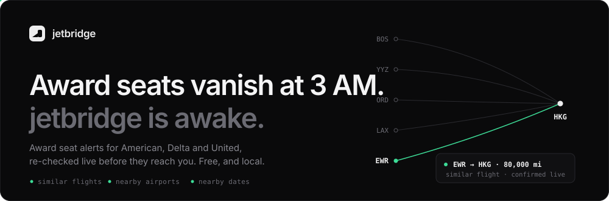
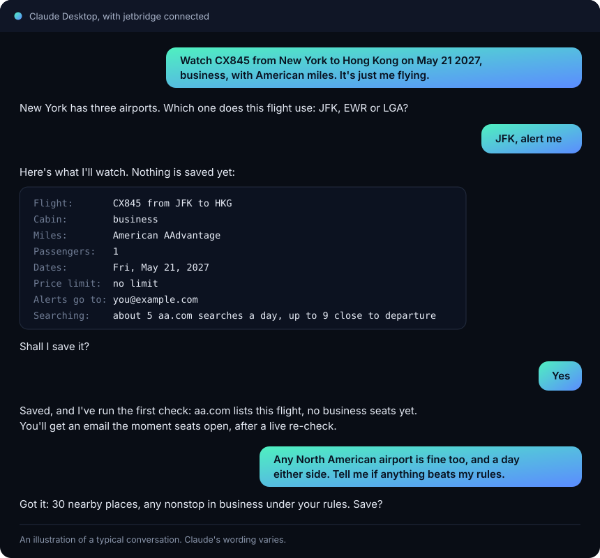
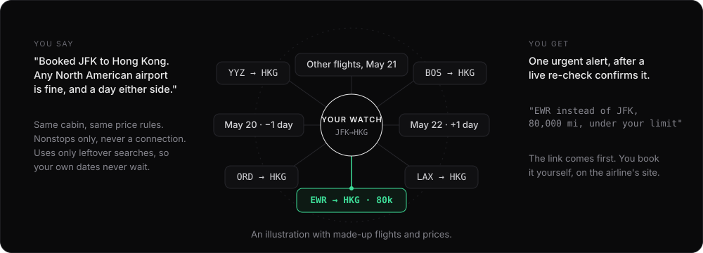
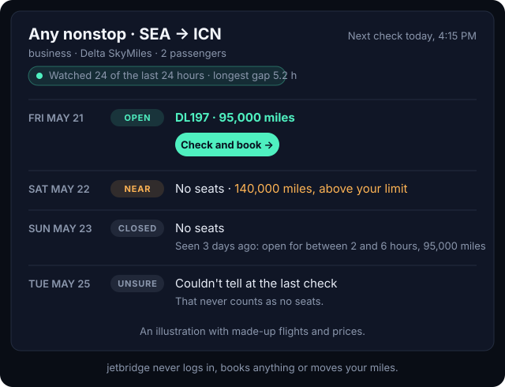
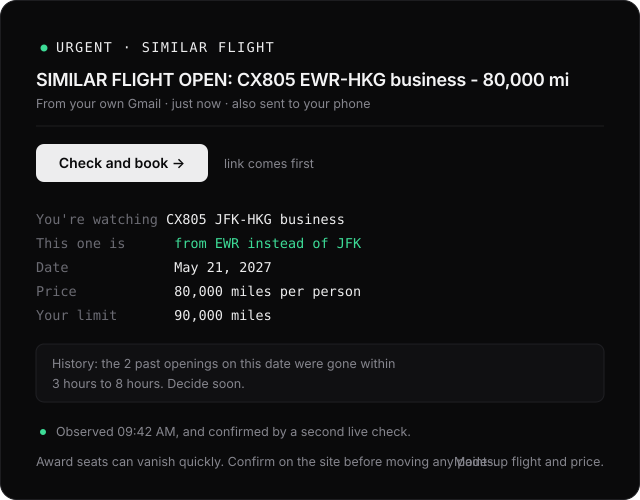

<p align="center">
  
</p>

<p align="center">
  <a href="https://github.com/xiuruichen/jetbridge/actions/workflows/ci.yml"></a>
  <a href="https://github.com/xiuruichen/jetbridge/tags"></a>
  <a href="LICENSE"></a>
  
  
</p>

<p align="center">
  <a href="#get-started"><b>Get started</b></a> ·
  <a href="#what-you-can-ask">What you can ask</a> ·
  <a href="#how-it-works">How it works</a> ·
  <a href="#how-it-compares">How it compares</a> ·
  <a href="#good-to-know">Good to know</a> ·
  <a href="docs/guide.md">Full guide</a>
</p>

<h3 align="center">Business-class award seats show up at 3 AM and are gone by breakfast.<br>jetbridge is the one that's awake.</h3>

Tell it the flight you want in plain English. It sits on your computer, checks the airline's own
website all day, and the moment seats open it **re-checks live to make sure they're real**, then sends
you the price and a booking link, before the seats are gone.

And it doesn't stop at the flight you named. It also catches the **sibling flight** that just opened,
the **day before or after**, and the **airport next door**, because that's usually where the deal is
hiding. Watch a whole route and it can search **all three programs at once**, so you see every
airline they can book.

**Free. No account, no subscription, no data leaving your machine.** American AAdvantage, Delta
SkyMiles and United MileagePlus, partner flights included.



## Why people get hooked

<p align="center">
  
</p>

- **It finds the deal you didn't ask for.** Another flight on your route opens, a day earlier, out of
  EWR instead of JFK: you get an urgent alert that says exactly why it counts. Booked YYZ to HKG and any
  North American airport would do? Say so, and it watches all of them for you.
- **Every airline, every program.** "Any airline from North America to Hong Kong" saves one watch per
  program, and each program's results include its alliance partners. When seats open on one, the alert
  says what else is open on the others, so you can compare before moving any points.
- **It sees the one-stops other sites skip.** Most alert sites only cover direct flights. Tell jetbridge a
  one-stop is fine and it counts bookable one-ticket trips too, every leg in your cabin, with a layover
  and total-time limit. A small airport to Hong Kong via a hub is exactly where this shows up.
- **No false alarms.** Every opening is searched again live a minute or two later. If the seats were
  only there for a moment, you never hear about it. If that second search can't tell,
  the email says it's unconfirmed.
- **It tells you how long you've got.** Each alert says how fast past openings on that date closed, and
  you get one follow-up when these seats have stayed open as long as past ones did. It reports what it
  has seen and doesn't guess.
- **It learns your flight's rhythm.** From your own history it can spot the time of day seats tend to
  appear and add a check there. Nothing leaves your computer, and with too little data it stays out of
  the way.
- **Snipe windows, when minutes matter.** Opt in per watch, and inside a time of day you pick (or the
  one it learned) it checks about every 15 minutes instead of every few hours. It's capped, only uses
  searches the day's plan leaves over, and is the most likely thing to get a site to block you, so it's
  off until you turn it on.
- **The last days get the most attention.** Seats can come back as bookings are cancelled, so dates in
  their last 3 days are checked about twice as often.
- **One step from alert to booking.** The link comes first, and `jetbridge book` opens the airline's own
  page on the right date. You sign in and book yourself.
- **Cheaper than what you paid.** Already booked? It alerts only when a seat costs less than you paid, so
  a better deal is never missed.
- **It proves it's watching.** See how many of the last 24 hours each flight stayed on schedule. An
  unclear answer is never reported as "no seats".
- **It's yours.** Free, private, runs on your computer as a guest, and never logs in, books anything or
  moves your miles.

<table>
  <tr>
    <td width="50%"></td>
    <td width="50%"></td>
  </tr>
  <tr>
    <td align="center"><b>See it all in chat</b></td>
    <td align="center"><b>Alerts with the link first</b></td>
  </tr>
</table>

> [!IMPORTANT]
> Automated searching likely goes against the airlines' terms of use, so [read how jetbridge handles
> that](docs/guide.md#blocks-and-the-airlines-terms) first. Checks only run while your computer is on,
> and seats that open and close between checks can be missed. Don't rely on it as your only way of
> finding seats.

## Get started

On Windows, open PowerShell and paste this line. Have a
[Gmail app password](https://myaccount.google.com/apppasswords) ready, which is how alerts get sent.

```powershell
irm https://raw.githubusercontent.com/xiuruichen/jetbridge/main/install.ps1 | iex
```

It asks before installing anything that's missing, offers to connect Claude Desktop if you have it, and
then asks you a few questions about your flight. Running a script from the internet means trusting it,
so you can [read it first](install.ps1).

<details>
<summary><b>On a Mac?</b> There's an experimental version.</summary>

<br>

It passes its automated tests on GitHub's Mac machines, but hasn't been tried on a real Mac yet. Airline
searches, sleep and Claude Desktop may not work as they do on Windows, and Chrome may appear during
checks. If you'd like to try it, paste this into Terminal, then
[follow the checklist and tell us how it went](docs/mac-testing.md).

```bash
curl -fsSL https://raw.githubusercontent.com/xiuruichen/jetbridge/main/install.sh | bash
```

</details>

## What you can ask

With [Claude Desktop](https://claude.com/download) connected, just say what you want in your own words.
Nothing is saved or deleted until you say yes. Claude is optional, and
[simple commands](docs/guide.md#command-reference) do all the same things.

| You could say | What happens |
|---|---|
| "Watch AA100 from New York to London in business on June 14-16 2027 using American miles" | Claude asks about anything missing, shows a review, then saves it and runs the first check |
| "Tell me about any nonstop business seats from Seattle to Seoul on Delta miles" | Watches every nonstop on that route, with its own alert for each flight that opens |
| "Watch CX805 or CX889, business or first" | One review covers them all, and they share their searches |
| "I booked DL197 on May 21 for 95k, tell me if it gets cheaper" | Alerts only below what you paid, without asking for your confirmation code |
| "We're four and can split into two and two on any nonstop" | Alerts only when enough nonstops are open to seat everyone |
| "Booked YYZ to HKG. Any North American airport works, and a day either side" | Watches every likely airport and nearby date, and alerts when one beats your rules |
| "Any airline from North America to Hong Kong, business, on every program" | Saves one watch per program, and alerts say what else is open on the others |
| "Check this one hard between 2 and 5 AM" | A snipe window: about every 15 minutes in that time of day, capped, after it shows you the risk |
| "A one-stop is fine if it's under 24 hours" | Also counts one-ticket one-stop trips inside those limits, and says where each connects |
| "Show me my flights" | Draws a board in the chat |
| "How has that flight been doing? Has it ever opened?" | Shows past openings, how long they lasted and their prices |
| "Lower the limit to 90k and add June 20" | Changes the watch and keeps its history |
| "Also alert ann@example.com" | Adds them, and they get one short note saying why. They don't need to install anything |
| "This one matters most" | That watch goes first and gets checked more often |
| "Why aren't I getting alerts?" | Finds the problem and how to fix it, or prepares a report you can post |

## How it works

1. **Your computer searches.** Every 15 minutes it runs whatever checks are due, using Chrome as a
   guest, one airline at a time, with waits between searches.
2. **It re-checks anything new.** If seats appear, it searches again live a minute or two later. The
   same goes for a similar flight, a nearby date or a nearby airport.
3. **You get the alert.** The email has the booking link first, and you can
   [add phone alerts](docs/guide.md#phone-alerts-optional) for when minutes matter. You book it yourself.
4. **It tells you when something's off.** A daily summary shows what it watched. If that email stops,
   the watcher isn't running.

More about [how checks are timed](docs/guide.md#how-checks-work), including how it learns a time of
day from your own openings once there are enough of them. There's no good public data on when seats are
released, so until then it only uses fixed rules of thumb.

## How it compares

jetbridge is for when you already know the flight or route you want. If you're flexible, a search site
covers far more, and the two work well together. Here's the best-known one, as checked on Nov 3, 2026.
Its details can change, so check [seats.aero](https://seats.aero) itself.

| | jetbridge | seats.aero |
|---|---|---|
| **Best for** | A flight or route you already know | Browsing many programs and routes |
| **Programs** | American, Delta and United | [24 programs](https://awardwallet.com/travel/seats-aero-guide/) |
| **Cost** | Free | [Free plan, or Pro at $12.99 a month from Nov 9, 2026](https://upgradedpoints.com/news/seats-aero-price-increase) |
| **How far ahead** | As far as the airline shows | [60 days free, a year on Pro](https://awardwallet.com/travel/seats-aero-guide/) |
| **Alerts** | One flight, any nonstop or one-stop, nearby dates and airports, re-checked live on the airline's site first | [Unlimited, for direct routes, by date, program and cabin](https://docs.seats.aero/article/43-creating-and-managing-alerts) |
| **Where it runs** | Your computer, which has to be on | Its own service, so your computer can be off |
| **In Claude** | Yes, on your computer | Yes, through its [official connector](https://seats.aero/mcp) |

## Good to know

- **Your computer has to be on, awake and logged in.** `jetbridge keep-awake on` stops it sleeping while
  plugged in, and you can undo that.
- **Sending alerts needs a Gmail account** with 2-Step Verification. Alerts can go to any address.
- **Sites can change or block it.** If that happens, it stops and tells you, rather than saying "no
  seats". [Here's how it stays careful](docs/guide.md#blocks-and-the-airlines-terms).
- **Nothing can promise you a seat.** The airline decides when seats exist and other people are looking
  too. jetbridge shortens how long it takes to see them and tell you, and that's all.
- **What leaves your computer:** searches to the airline, emails through Gmail, anything you say to
  Claude, and [a few optional things](docs/guide.md#where-your-data-lives).

## Learn more

- [The full guide](docs/guide.md): every option, command, email and fix
- [Changelog](CHANGELOG.md)
- [Contributing](CONTRIBUTING.md) and [how your details are handled](SECURITY.md)
- [Something wrong?](https://github.com/xiuruichen/jetbridge/issues/new/choose) Run `jetbridge report`
  or ask Claude to "report this problem". It prepares an issue with nothing personal in it

## License

[MIT](LICENSE). jetbridge isn't affiliated with any airline or with Anthropic.
