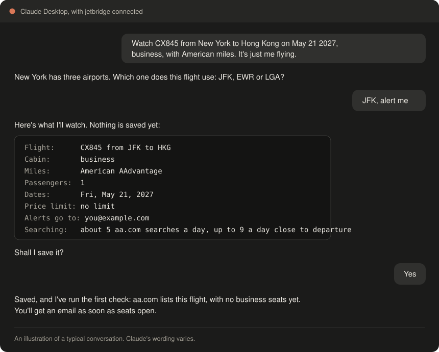

# jetbridge

[](https://github.com/xiuruichen/jetbridge/actions/workflows/ci.yml)
[](LICENSE)

-lightgrey.svg)


**Get an email when award seats open on the exact flight you want.**

Tell jetbridge the flight, cabin, dates and miles, for example *AA100 in business on June 14-16,
2027, bookable with American miles*. It searches the airline's website several times a day on your
own PC, and emails you the price and a booking link as soon as seats appear.



- **Three miles programs:** American AAdvantage, Delta SkyMiles and United MileagePlus, including
  partner flights they sell.
- **Chat or commands:** run it all by [chatting in Claude Desktop](#using-it-through-claude), or with
  [simple commands](#command-reference). Claude is optional.
- **Runs on your computer:** there's no account or subscription, and your details stay on your computer.
- **Alerts for anyone:** each watch can alert different people, so friends and family don't need to
  install anything.
- **Proves it's watching:** the daily summary and chat show how many of the last 24 hours each flight
  stayed on schedule, and each flight builds up its own record of past openings and prices.
- **Double-checked:** seats are searched again live before an alert goes out, so you're not sent
  after seats that were only there for a moment.
- **Careful by design:** it searches as a guest at low volume, and backs off if a site pushes back. It
  never logs in, books anything or moves your miles.

> [!IMPORTANT]
> Automated searching likely goes against the airlines' terms of use, so [read how jetbridge handles
> that](#blocks-and-the-airlines-terms) first. Checks only run while your computer is on, so seats that
> open and close between checks can be missed. Don't rely on it as your only way of finding seats.

## Get started

Open PowerShell on Windows and paste this line. [Quick start](#quick-start) explains what it does.

```powershell
irm https://raw.githubusercontent.com/xiuruichen/jetbridge/main/install.ps1 | iex
```

> [!WARNING]
> **On a Mac, jetbridge is experimental and hasn't been tried on a real Mac yet.** Airline searches,
> sleep and Claude Desktop may not work as they do on Windows, and Chrome may appear during checks.
> If you'd like to try it, paste this into Terminal, then
> [follow the checklist and tell us how it went](docs/mac-testing.md).
>
> ```bash
> curl -fsSL https://raw.githubusercontent.com/xiuruichen/jetbridge/main/install.sh | bash
> ```

## Contents

- [Requirements](#requirements)
- [Quick start](#quick-start)
- [Using it through Claude](#using-it-through-claude)
- [Installing by hand](#installing-by-hand)
- [Adding a watch](#adding-a-watch)
- [Sending alerts to other people](#sending-alerts-to-other-people)
- [Checking on your watches](#checking-on-your-watches)
- [The emails you'll get](#the-emails-youll-get)
- [Customizing alert headlines](#customizing-alert-headlines)
- [Phone alerts (optional)](#phone-alerts-optional)
- [When you get a SEATS OPEN email](#when-you-get-a-seats-open-email)
- [How checks work](#how-checks-work)
- [Limitations](#limitations)
- [Blocks and the airlines' terms](#blocks-and-the-airlines-terms)
- [Command reference](#command-reference)
- [Troubleshooting](#troubleshooting)
- [Where your data lives](#where-your-data-lives)
- [Uninstalling](#uninstalling)
- [Development](#development)
- [Changelog](CHANGELOG.md)
- [License](#license)

## Requirements

- **Windows**, or a Mac if you'd like to try the [experimental version](docs/mac-testing.md)
- **Google Chrome**, installed normally
- **[uv](https://docs.astral.sh/uv/)**, which installs Python 3.12 and the other dependencies
- **[Git](https://git-scm.com/)**, to download jetbridge
- **A Gmail account with 2-Step Verification**, to send the alerts. They can go to any address
- **[Claude Desktop](https://claude.com/download)** (optional), to manage your watches by chatting

The one-step install below sets up Git, uv and Chrome for you if they're missing.

## Quick start

Open PowerShell and paste this one line:

```powershell
irm https://raw.githubusercontent.com/xiuruichen/jetbridge/main/install.ps1 | iex
```

Have a [Gmail app password](https://myaccount.google.com/apppasswords) ready. The install then:

1. Asks before installing anything that's missing.
2. Downloads jetbridge to your home folder and adds a `jetbridge` command you can run from any new
   PowerShell window.
3. Offers to connect [Claude Desktop](#using-it-through-claude), if you have it.
4. Starts `jetbridge start`, which asks a few questions and turns on automatic checks.

That's all you need.

Running a script from the internet means trusting it, so you can
[read it first](https://github.com/xiuruichen/jetbridge/blob/main/install.ps1).

To add more flights later, run `jetbridge start`. To update, run `jetbridge update` or ask Claude.
The daily summary tells you when there's a new version.

After [installing by hand](#installing-by-hand), run commands from the project folder and start them
with `uv run`, like `uv run jetbridge start`.

## Using it through Claude

If you use the Claude Desktop app, you can manage your watches by chatting instead of typing
commands. Claude is optional, and checks and emails keep running whether or not the app is open.

### Connect Claude Desktop

The one-step install offers to do this if Claude Desktop is already installed. If you install it
later, or installed jetbridge by hand:

1. Open Claude Desktop once and sign in.
2. Run this in PowerShell. After installing by hand, use `uv run jetbridge` from the project folder.

   ```powershell
   jetbridge claude connect
   ```

3. Quit Claude Desktop fully, including from the system tray, and reopen it.
4. In a new chat, say: "Help me get started with jetbridge."

You can also start from a menu: **+ > Connectors > Add from jetbridge** has starting points such as
**Watch a flight**. **+ > Connectors > Tool access** is also where Claude Desktop keeps its tool
settings.

Claude Desktop often asks your permission before using a jetbridge tool, even just to read your
watches. Choose **Allow once** or **Always allow**. It's safest to keep choosing **Allow once** for
the tools that save or remove a watch, so you can look at the request first.

### What you can ask

Just say what you want, in your own words. You don't need any commands, flight codes or watch
numbers. Some examples:

- **Getting set up:** "Help me get started with jetbridge." Claude takes you through the notice and
  email, and can send a test email.
- **Adding a flight:** "Watch AA100 from New York to London in business on June 14-16 2027 using
  American miles, for 1 passenger." Claude asks about anything you left out.
- **Not sure of the flight:** "What nonstop business flights go from Seattle to Seoul on May 21 on
  Delta miles?"
- **Checking in:** "Show me my flights" draws a board in the chat. "Which flights am I watching?", "How has my AA100 watch been doing? Has it ever
  opened?" or "Check it now."
- **Making changes:** "Pause my AA100 watch", "Start it again", "Delete it", "Also alert
  ann@example.com" or "Stop alerting Ann." "Add June 20 to that watch" and "Lower the limit to 90k" keep its history. To change a
  cabin, just ask: Claude adds the new version and offers to remove the old one, whose history goes
  with it.
- **Settings:** "Turn off the daily summary", "Make the seats-open headline say DEAL FOUND", "Turn
  off automatic checks" or "Keep this computer awake while it's plugged in."
- **When something seems wrong:** "Is my watcher healthy?" or "Why aren't I getting alerts?"

### What to expect

- **Nothing is saved or deleted until you say yes.** Claude asks for anything missing and shows you
  the same review as `jetbridge start`. Read it, especially who gets the alerts, then say yes or ask
  for a change.
- **Your Gmail password never goes in the chat.** Claude opens a small private window on your computer, and
  the password goes straight to Windows Credential Manager, or Keychain on a Mac. Never paste it into
  a chat.
- **Automatic checks turn on by themselves** when you save your first flight.
- **You find out straight away if a watch looks wrong.** Claude checks a new watch right after saving
  it, and tells you if the site can't see that flight. It may also mention other flights it saw with
  seats on that route.
- **"Show me my flights" draws a board in the chat,** with each date, proof of watching and any past
  openings. Claude Desktop shows this directly in the conversation.
- **Live checks take a while.** A check can take a few minutes, because Chrome has to start and load
  the airline's site. Claude will say when it's still going, and may ask permission again to collect
  the answer. When seats are open, it gives you the booking link.
- **A check can send real emails.** If it finds seats have opened, everyone on that watch gets an
  alert, the same as a scheduled check.
- **It only works on the computer running jetbridge.** You can't use it from claude.ai or the phone apps.
- **What Claude sees.** The details it handles in your chat, including your watches and alert
  addresses, go to Claude like the rest of the conversation.

If you move the project folder, run `jetbridge claude connect` again. To disconnect, run `jetbridge
claude disconnect`. This only removes Claude's access: your watches and alerts carry on.

`connect` changes only jetbridge's entry in Claude Desktop's config file. Your other servers and
settings are kept, the previous version is saved next to it as
`claude_desktop_config.json.jetbridge-backup`, and a file it can't understand is left alone.

### Claude Code

Open [Claude Code](https://claude.com/claude-code) in the project folder and approve the `jetbridge`
MCP server when asked. It needs `uv` on your PATH. You can ask the same things there.

## Installing by hand

### 1. Install

```powershell
git clone https://github.com/xiuruichen/jetbridge.git
cd jetbridge
```

If the project is in a synced folder such as OneDrive, keep its Python environment outside
that folder. Run this once, then open a new PowerShell window in the project folder:

```powershell
setx UV_PROJECT_ENVIRONMENT "$env:LOCALAPPDATA\jetbridge\venv"
```

Then install:

```powershell
uv sync
```

### 2. Answer a few questions

This is the easiest way to set everything up:

```powershell
uv run jetbridge start
```

It shows a short notice about the risks and limits, sets up email, asks where and when you're flying, can look up the flights on your route, shows
you what it's about to save, and turns on automatic checks. You'll need a
[Gmail app password](https://myaccount.google.com/apppasswords). You can run it again to add more
flights, and it's the only step you need. The rest of this section does the same thing one command
at a time.

### 3. Set up email by hand

Create an app password at <https://myaccount.google.com/apppasswords>, then run:

```powershell
uv run jetbridge notify setup
```

It asks for the Gmail address to send from, your own address for alerts and health warnings, and
the app password. Then it sends a test email. If nothing arrives, check your spam folder.

### 4. Add a flight

```powershell
uv run jetbridge watch add AA100 --from JFK --to LHR --dates 2027-06-14..2027-06-16 --cabin business
```

It asks who should get the seat alerts. Type one or more addresses separated by commas, or press
Enter to send them to yourself. It then prints a watch ID, such as `[1]`, which the other commands
use.

### 5. Try one check

```powershell
uv run jetbridge check 1
```

This takes a minute or two, because searches are spaced out on purpose. You should see a result
for each date:

```text
[1] AA100 JFK-LHR business Jun 14: not_offered (no business seats)
[1] AA100 JFK-LHR business Jun 15: not_offered (no business seats)
[1] AA100 JFK-LHR business Jun 16: not_offered (no business seats)
3 check(s), 0 email(s) sent.
```

### 6. Turn on automatic checks

```powershell
uv run jetbridge schedule install
```

### 7. Confirm everything works

```powershell
uv run jetbridge doctor
```

Every line should say `OK`. Anything marked `FAIL` tells you how to fix it.

You're done. You don't need to keep a window open, but the computer has to stay on, awake and logged
in. See [Limitations](#limitations).

## Adding a watch

```text
jetbridge watch add FLIGHT --from AAA --to BBB --dates DATES [options]
```

| Option | Default | What it does |
|---|---|---|
| `FLIGHT` | required | Flight number, such as `AA100`, or `any` for [any nonstop](#any-nonstop-or-several-at-once) |
| `--from`, `--to` | required | The airports this flight actually flies between |
| `--dates` | required | Up to 14 dates: `2027-06-14..2027-06-16`, `2027-06-14,2027-06-18`, or a mix |
| `--cabin` | `business` | `economy`, `premium`, `business` or `first` |
| `--pax` | `1` | Number of passengers to search for |
| `--checks-per-day` | `6` | How often to check, from 1 to 24 |
| `--max-miles` | none | Treat seats above this per-person price as not available |
| `--notify` | asks you | Who gets seat alerts: `a@x.com,b@y.com`, or `me` for only you |
| `--program` | `american` | Whose miles to search: `american`, `delta` or `united` |

### Any nonstop, or several at once

If you'd take any nonstop on a route, use `any` as the flight, or tell Claude "any nonstop". Each flight
that opens gets the same live re-check and its own alert. Connections never count.

```powershell
jetbridge watch add any --from SEA --to ICN --dates 2027-05-21..2027-05-23 --cabin business --program delta
```

In chat, you can also ask for several at once: "Watch CX805 or CX889, business or first." One review
covers them all. Each search already returns every flight on the route, so none of this adds searches.

### Getting these right

- **Program:** this is whose miles you'd use, not who flies the plane. Partner flights can appear:
  American can show Cathay Pacific, for example. An airline that doesn't sell a flight with its
  miles will show it as `not_listed`. To compare programs, add one watch for each.
- **Route:** use the airports of that exact flight, because the sites search by route. A flight
  tracker will show them. With a wrong route, the flight simply never appears. A city's other
  airports don't count: a watch to Tokyo Haneda won't match a flight landing at Narita.
- **Dates:** use the local departure date at the origin airport.
- **Connections:** only the flight on its own counts, even on an `any` watch. An itinerary that connects onto it from
  another city doesn't, so watch each flight separately if you need more than one.
- **Cabin:** every leg has to be in the cabin you asked for. If a site sells a "business" fare
  that's actually flown in another cabin, it doesn't count. A first-class seat doesn't count for
  a business watch either, so add a second watch if you'd take either. On US domestic flights,
  United's and Delta's front cabin usually counts as `first`.
- **Party size:** a watch for 2 only reports seats the site offers to a party of 2. If you could
  split up, add a separate watch for 1. Prices can also change with party size.
- **Checks per day:** this is per date, so 6 checks across 3 dates is about 18 searches a day, and
  [the pace changes](#how-checks-work) as the date gets closer. The review shows how many searches
  that means now and at the busiest. Be conservative: more searching makes a block more likely.

### Examples

```powershell
# Two passengers, only if 120,000 miles or less each
jetbridge watch add AA100 --from JFK --to LHR --dates 2027-06-14,2027-06-16 --pax 2 --max-miles 120000

# First class, checked eight times a day
jetbridge watch add AA100 --from JFK --to LHR --dates 2027-06-14 --cabin first --checks-per-day 8
```

### Managing watches

```powershell
jetbridge watch list        # every watch
jetbridge watch pause 1     # stop checking, keep the history
jetbridge watch resume 1    # start again, with a check on the next run
jetbridge watch rm 1        # delete the watch and its history
```

Watches finish on their own once all their dates have passed.

To change dates, the price limit or the pace, edit the watch, which keeps its history:

```powershell
jetbridge watch edit 1 --dates 2027-06-14..2027-06-20
jetbridge watch edit 1 --max-miles 90000
jetbridge watch edit 1 --no-limit --checks-per-day 4
```

A different flight, route, cabin, program or party size is a different watch, because the old
history wouldn't apply. Add the new one and remove the old one.

## Sending alerts to other people

Each watch has its own list of up to 10 people. They don't need to install anything, and they don't
need a Gmail address.

```powershell
# Asks who to alert
jetbridge watch add AA100 --from JFK --to LHR --dates 2027-06-14 --cabin business

# Or say it up front
jetbridge watch add AA100 --from JFK --to LHR --dates 2027-06-14 --notify "ann@example.com,bo@example.org"

# Make sure an address works before relying on it
jetbridge notify test --to ann@example.com

# See or replace who a watch alerts ("me" means only you)
jetbridge watch recipients 1
jetbridge watch recipients 1 ann@example.com,carol@example.com
jetbridge watch recipients 1 me
```

Replacing the list takes effect from the next alert. To include yourself alongside other people, add
your own address to the list.

| Email | Who gets it |
|---|---|
| Seat alerts: open, unconfirmed, price drop, more seats, still open, gone | That watch's list, or you if the list is empty |
| Daily summary and warnings about the watcher | Only you |

A few things to know:

- **Welcome note:** the first time you add someone, they get one short email saying what it's for
  and asking them to mark it "not spam". If Gmail refuses the address, you find out before a real
  alert goes missing.
- **Privacy:** each person gets a separate email and can't see who else is on the list. Your Gmail
  address is the sender, and replies come to you.
- **Footer:** emails to other people say that someone added them to a flight watch, and to reply if
  they'd like to be removed. Only add people who want these, and remove anyone who asks.
- **Different people, different flights:** add a watch per person or group. Watches on the same
  route, date and party size share one search, so this doesn't add searches.
- **Party size:** each watch's `--pax` should match that traveler's group.
- **Bad addresses:** if Gmail refuses an address outright, everyone else still gets their alert and
  you're emailed what that person missed. If an address bounces later, the bounce notice comes to your
  Gmail instead, so test new addresses with `notify test --to`.
- **Spam filters:** ask each person to mark the first email as "not spam". A missed alert is the
  main risk, because other people don't get the daily summary and won't notice if it stops.

## Checking on your watches

```powershell
jetbridge status       # the latest state of every date, and the next check
jetbridge history 1    # past results for watch 1, newest first
jetbridge insights 1   # what's been seen so far: openings, how long they lasted, prices
jetbridge doctor       # is everything working?
```

Each result is one of these:

| Result | Meaning |
|---|---|
| `available` | The flight has seats in your cabin, within any miles limit |
| `not_offered` | The site listed the flight, but with no qualifying seats |
| `not_listed` | The site answered, but this flight wasn't in the results |
| `unknown` | jetbridge couldn't tell, for example because of a block or an error |

**`unknown` never means "no seats".** It can't trigger a seats alert, and it can't mark an open
date as closed.

Over time, each watch builds up a record of what happened on your flight:

- **Past openings:** how many times seats appeared, how long they lasted, at what price and how far
  ahead of departure. Checks are hours apart, so lengths are ranges like "between 2 and 6 hours". A
  seats alert includes a short line about this. It's a record of what was seen, not a prediction.
- **Near misses:** if seats appear above your price limit, the daily summary and chat show the price.
  They don't count as open and don't send an alert.
- **Other flights:** each search lists other flights on that route and date anyway. If one has seats
  in your cabin while yours doesn't, the daily summary and chat mention it, at no extra searches.
  jetbridge isn't watching those flights and hasn't re-checked them, so confirm on the site. The list
  may be incomplete.

## The emails you'll get

| Email | When it's sent |
|---|---|
| **SEATS OPEN** | Seats appeared, and a live re-check 1-2 minutes later confirmed them |
| **SEATS MAY BE OPEN (unconfirmed)** | Seats appeared, but the re-check couldn't get a clear answer |
| **PRICE DROP** | An open date got cheaper |
| **MORE SEATS** | An open date gained seats (only when the site states a count) |
| **STILL OPEN** | One reminder a day while seats stay open |
| **Seats gone** | An open date closed |
| **jetbridge can't see...** | No clear answer on any date for 24 hours |
| **A site's page format may have changed** | Two checks in a row couldn't be read, so the parser may need fixing |
| **... should open tomorrow** | The day before a date should become bookable. Takes no searches |
| **jetbridge daily** | A summary, on the first run after 8 AM |

If seats appear but are gone by the re-check, it's logged in `history` and no email is sent.

The daily summary also shows proof of watching for each flight: how many of the last 24 hours it
stayed on schedule, and the longest gap between clear answers.

**If the daily email stops arriving, the watcher isn't running.** The computer can't send anything
while it's off, so that missing email is your warning. To turn the summary off, run
`jetbridge notify digest off`, but you'd lose that signal.

If sending fails, for example when you're offline, the email stays queued and is retried on later
runs. Seat alerts wait until they can be sent, so check the `Observed` time. Daily summaries more
than a day old are dropped.

## Customizing alert headlines

You can reword the headline at the start of each seat alert's subject:

```powershell
jetbridge notify headline                                      # show all of them
jetbridge notify headline seats_open "DEAL FOUND, BOOK NOW"    # change one
jetbridge notify headline seats_open --reset                   # back to the built-in text
```

The alerts are `seats_open`, `seats_open_unconfirmed`, `price_drop`, `more_seats`, `reminder` and
`seats_gone`. The flight, cabin, date and price still follow the headline. With the headline above,
a subject reads `DEAL FOUND, BOOK NOW: AA100 business on Jun 14, 2027 - 110,000 mi`.

This changes the wording only, not when alerts are sent. Headlines are saved in `alerts.json` in your
state folder, so they stay on your computer and survive `notify setup`. If that file ever can't be read,
alerts still go out with the built-in wording and `doctor` tells you.

## Phone alerts (optional)

Email can take a while to get noticed, and seats can go in minutes. To get a phone alert too, ask
Claude to "set up phone alerts" or run:

```powershell
jetbridge notify push on      # explains it and asks first
jetbridge notify push test
jetbridge notify push off
```

This uses [ntfy](https://ntfy.sh), a free service with no account. Only seats-open, unconfirmed and
price-drop alerts go this way, and each one still comes by email. **The alert's text and booking link
pass through ntfy.sh**, and anyone who knows your private channel name could read them, so jetbridge
makes a long random name, keeps it on your computer and never shows it in a chat. Phone alerts only go to
you, not to other people on a watch. An alert that can't be sent within an hour is dropped, because
it would no longer be useful, and the email still arrives.

## When you get a SEATS OPEN email

1. **Open the link at the top of the email.** It fills in that route, date and party size. American goes
   straight to the results. Delta opens a date grid with your date selected, so press Continue.
   United asks you to sign in before it shows prices in miles.
2. **Find your flight** and check the price, cabin and taxes. Award seats can disappear in minutes.
3. **Book it yourself.** If you need to transfer points first, confirm the seats are still there,
   because transfers generally can't be undone.

A few details in the email:

- **`Seats: at least 1`** means the site didn't state a count, which is common on aa.com. The
  number is the party size searched, and the real count may be higher.
- **`Seats: at least 9`** comes from Delta and United, which stop counting at 9.
- **`Note: dynamic pricing`** comes from aa.com's data, and that price can change.
- **`Note: aa.com says this must be booked at the airport`** comes from aa.com too, so check it
  before planning around that fare.

## How checks work

1. Every 15 minutes, your computer runs `jetbridge tick`, which does whatever is due and exits.
2. Each date's next check is set from the watch's checks per day, with random variation of 30%
   either way. At 6 a day, that's roughly every 3-5 hours. The pace changes with how far off the date
   is, because seats are often released close to departure:

   | Date is | Checks a day, if you chose 6 |
   |---|---|
   | More than 60 days away | 5 (never below 2 unless you chose fewer) |
   | 15-60 days away | 6 |
   | 14 days away or less | 9 (up to 24) |
   | In the first days after a program can show it | 9 (up to 24) |

   A few things change this, always within the same limits:

   - **Movement:** if seats vanish, a price changes, another flight on the route opens or a nearby
     date opens, that date gets up to 3 extra checks over the next several hours.
   - **Booking night:** a date gets one check just after midnight at the airline's home on the day it
     should become bookable, if your computer is awake. Evidence for this timing is thin, so it's a cheap
     experiment.
   - **Priority:** `jetbridge watch priority 1 high` makes a watch go first and get checked about 1.5
     times as often.
   - **After a block:** planned searching on that site is halved for a day, then recovers.

   These are rules of thumb about where searches do the most good, not predictions. There's no good
   public data on when seats are released, so the sizes were chosen with a
   [simulator](tools/simulate.py) of made-up patterns: enough tilt to help if seats open late, without
   doing worse if there's no pattern at all. A manual check looks at every date the program can show.
3. Chrome opens off-screen and searches one airline at a time, waiting 20-60 seconds between
   searches on the same site. Watches on the same route, date, party size and program share one search.
4. If seats have just appeared, it waits 1-2 minutes and searches again before alerting you.
5. Results are saved, emails are sent and Chrome closes.

After sleep or downtime it runs one catch-up check, never a burst of missed ones.

## Limitations

- **It only runs while this computer is on, awake and logged in.** Chrome needs a desktop session, so
  checks stop while the computer sleeps or is signed out. To catch seats overnight, run `jetbridge
  keep-awake on`, which stops it sleeping while plugged in. `jetbridge keep-awake off` puts your old
  settings back, and battery settings never change. `doctor` tells you if sleep would stop checks.
- **Short-lived seats can be missed.** Checks are hours apart, so seats that open and close between
  them are never seen. More checks per day narrows that gap but raises the risk of a block.
- **A flight that's `not_listed` isn't necessarily wrong.** Sites may leave out flights with no
  award space, or may not sell that flight with their miles. If a flight has never appeared after 6 clear checks on every date, the daily email
  suggests checking the flight number and route.
- **Codeshares:** jetbridge matches the flight number the site shows. If a site lists the flight
  under a different number, watch that number instead.
- **Three programs.** American, Delta and United are supported. Each shows only what it offers for
  its own miles, and other programs may see different space.
- **Partner flights.** Any partner a program sells works, with no setup per airline. If a site ever
  shows a fare jetbridge can't place in a cabin, seats it can read still alert you, and the rest
  show as `unknown` with the fare named. On Delta, a partner's top cabin is read from Delta's
  business column, so a partner's first class would show as `business`.
- **Dates too far ahead.** Programs only show flights so far in advance: about 331 days for American
  and Delta, and 337 for United. jetbridge doesn't search a date until 3 days before it should open,
  and the review tells you when that is.
- **Sites can change without notice.** If a site's pages change, its checks turn `unknown`, and you
  get an email saying so, but that program won't work again until its parser is updated. Other
  programs keep working.

## Blocks and the airlines' terms

Automated searching likely goes against these airlines' terms of use, so you're accepting that risk
by running this. jetbridge keeps the risk low: it never logs in, so your frequent flyer accounts
aren't involved, and it searches at low volume. It drives Chrome through
[patchright](https://github.com/Kaliiiiiiiiii-Vinyzu/patchright-python), a browser-automation tool
built to look like normal Chrome, because these sites often refuse ordinary automation. Each site
has its own hard limit:

| Site | Most requests |
|---|---|
| aa.com | 10 per 10 minutes |
| delta.com | 20 per 5 minutes |
| united.com | 30 per 5 minutes |

Planned searching uses up to 120 requests per site in 24 hours, with the most deserving dates first.
Every date still gets at least 2 checks a day, or 1 if you chose 1. No site ever gets more than 150
requests in any 24 hours. Past that, checks are put off and show as `unknown` until the count falls.

A single check can use more than one request: United needs a guest token and then the search, and
Delta asks for each page of results separately. Opening a site's home page counts too.

If a site shows a "confirm you're human" page or blocks a request, jetbridge:

1. Stops searching that site immediately and doesn't retry. Other sites carry on.
2. Rests that site for 10 minutes, doubling each time it happens again within 6 hours, up to 4 hours.
3. Records the checks it skipped as `unknown` and reschedules them for after the rest.

It never tries to solve the human check. `status` shows any rest in progress. If blocks keep
happening, lower `--checks-per-day`.

## Command reference

Run these as `jetbridge ...` after the one-step install, or `uv run jetbridge ...` from the project
folder. Add `--help` to any command for details.

| Command | What it does |
|---|---|
| `start` | Set up jetbridge and add flights by answering questions |
| `claude connect` / `claude disconnect` / `claude status` | Use jetbridge from Claude Desktop |
| `watch add FLIGHT ...` | Start watching a flight |
| `watch list` | List every watch |
| `watch edit ID ...` | Change dates, price limit or pace, keeping the history |
| `watch priority ID high` / `normal` | Put a watch first, within the same daily limits |
| `watch recipients ID [ADDRESSES]` | Show or replace who gets seat alerts |
| `watch pause ID` / `watch resume ID` | Stop or restart checking |
| `watch rm ID` | Delete a watch and its history |
| `status` | Current state of every active watch |
| `history ID [--limit N]` | Past results for a watch |
| `insights ID` | What's been seen so far: openings, how long they lasted, prices |
| `check ID` | Check one active watch now, still within the rate limit |
| `doctor` | Find out what's wrong |
| `keep-awake on` / `off` | Stop this computer sleeping while plugged in, or put its settings back |
| `uninstall` | Remove jetbridge's checks, watches, settings and saved password |
| `--version` | Show the version |
| `update` | Install the newest jetbridge |
| `report` | Prepare a problem report to read and post, with nothing personal in it |
| `notify setup` | Save Gmail details and send a test email |
| `notify push on` / `off` / `test` | Phone alerts through ntfy |
| `notify test [--to ADDRESS]` | Send a test email to you or someone else |
| `notify digest on` / `off` | Turn the daily summary on or off |
| `notify headline [KIND] [TEXT]` | Show or change seat alert headlines |
| `schedule install` / `remove` | Add or remove the scheduled task |

## Troubleshooting

Start with `jetbridge doctor`, which covers most problems.

If that doesn't solve it, `jetbridge report`, or asking Claude to "report this problem", prepares a
GitHub issue for you to read and post. It has the version, which checks failed and the structure of
any saved airline replies, with every value removed. Nothing is sent unless you post it.

**`uv` isn't recognized.** Close and reopen PowerShell. If it still fails, install uv and make sure
its folder is on your PATH.

**`jetbridge` isn't recognized.** Close and reopen PowerShell. After installing by hand, use
`uv run jetbridge` from the project folder.

**Claude Desktop doesn't show the jetbridge tools.** Run `jetbridge claude status`. If it says
connected, quit Claude Desktop fully, including from the system tray, and reopen it. Run `jetbridge
claude connect` if it says anything else. If they still don't appear, the app's logs are in `%LOCALAPPDATA%\Claude\logs`, in
`mcp-server-jetbridge.log`.

**Updating fails with "being used by another process".** Claude Desktop is keeping a jetbridge
program open. Quit it fully, including from the system tray, and run `jetbridge update` again.

**The test email fails with a login error.** Use an app password, not your normal Gmail password,
and make sure 2-Step Verification is on. Google Workspace accounts, including school ones, may have
app passwords turned off, so try a personal Gmail. Run `notify setup` again to replace the details.

**`watch add` says no recipient was given.** It couldn't ask you, for example because it was run
from a script. Add `--notify me` or `--notify a@x.com`.

**The test email never arrives.** Check spam, then mark it as "not spam" so alerts land in your inbox.

**A check says `blocked`, or `status` says a site is RESTING.** This is normal. Leave it alone and
checks resume after the rest. Running `check` during a rest won't get around it.

**Everything is `unknown` with a site error code.** The site returned an error that jetbridge can't
interpret, so it reports "couldn't tell". Check `jetbridge history ID`. The raw response is
saved for diagnosis.

**A flight is always `not_listed`.** Check the flight number, route and date against a flight
tracker, and confirm the airline has opened its schedule for those dates. Then search the route
yourself on the airline's site to see how the flight is listed.

**"another jetbridge check is already running".** Only one check can use its Chrome profile at a
time. Wait for it to finish and try again.

**No checks seem to be running.** Make sure you're logged in and `doctor` shows the task as installed,
then compare `Last tick` in `status` with the current time. Scheduled output is written to
`%LOCALAPPDATA%\jetbridge\jetbridge.log`. Runs with nothing due don't log anything.

**You see Chrome in the taskbar.** That's jetbridge running a check. Its window is off-screen and
closes by itself. It uses its own profile, so it doesn't touch your normal Chrome data. To watch
it work, run this and then do a `check`:

```powershell
$env:JETBRIDGE_SHOW_BROWSER = "1"
```

## Where your data lives

Everything is on your computer. Nothing goes anywhere except:

- searches to the airline sites
- emails through Gmail
- whatever Claude handles in your chat, if you [use it through Claude](#using-it-through-claude)
- seat alerts through ntfy.sh, if you [turn on phone alerts](#phone-alerts-optional)
- one plain request a day to GitHub to see if there's a new version, which carries nothing about you.
  Set `JETBRIDGE_NO_UPDATE_CHECK=1` to stop it

| What | Where |
|---|---|
| Database, config, custom headlines and log | `%LOCALAPPDATA%\jetbridge\` |
| jetbridge's Chrome profile | `%LOCALAPPDATA%\jetbridge\profiles\` |
| Failed responses, for repairs (newest 50) | `%LOCALAPPDATA%\jetbridge\raw\` |
| On a Mac | `~/Library/Application Support/jetbridge/` in place of the folder above |
| Gmail app password | Windows Credential Manager or Mac Keychain, under `jetbridge-gmail` |
| Private phone alert channel name, if you use it | `%LOCALAPPDATA%\\jetbridge\\push.json` |

Set the `JETBRIDGE_HOME` environment variable to use a different folder.

## Uninstalling

```powershell
jetbridge uninstall
```

After you confirm, this stops the checks and disconnects Claude Desktop. It also deletes your
watches, settings, saved Gmail password and the `jetbridge` command. Then:

1. Revoke the app password in [your Google account](https://myaccount.google.com/apppasswords).
2. Delete the project folder, usually `jetbridge` in your home folder.

## Development

```powershell
uv run pytest               # offline, using recorded airline responses
uv run ruff check .
uv run ruff format .
```

| Path | What's in it |
|---|---|
| `src/jetbridge/matcher.py` | Turns a site's answer into a result for one flight (pure) |
| `src/jetbridge/alerts.py` | Alert rules and email text (pure) |
| `src/jetbridge/scheduler.py` | What's due, booking windows, timing and shared searches (pure) |
| `src/jetbridge/insights.py` | What a watch's own record shows (pure) |
| `src/jetbridge/runner.py` | One full run: check, confirm, alert, report health |
| `src/jetbridge/store.py` | SQLite storage and the email queue |
| `src/jetbridge/acquire/american.py`, `delta.py`, `united.py` | Each site's requests and response parsing |
| `src/jetbridge/acquire/sites.py` | The list of sites. Adding a program starts here |
| `src/jetbridge/acquire/detect.py` | Recognizes blocks and human checks |
| `src/jetbridge/acquire/governor.py` | Each site's rate limit and rest periods |
| `src/jetbridge/acquire/broker.py`, `fetcher.py` | Chrome session and classified answers |
| `src/jetbridge/notify/email.py` | Gmail sending and queue flushing |
| `src/jetbridge/autorun.py`, `winsched.py`, `launchd.py` | The background task on each system |
| `src/jetbridge/platforms.py` | The other differences between Windows and a Mac |
| `src/jetbridge/cli.py`, `mcp_server.py`, `board.py`, `service.py` | Commands, Claude tools, the in-chat board and shared wiring |
| `src/jetbridge/claude_desktop.py`, `doctor.py`, `power.py`, `uninstall.py` | Connecting Claude, health checks, sleep settings, removal |

See [CONTRIBUTING.md](CONTRIBUTING.md) to get involved, and [SECURITY.md](SECURITY.md) for how
your details are handled and how to report a problem.

Set `JETBRIDGE_KEEP_RAW=1` to save successful responses too, which is useful for recording test
fixtures. Rules that must not be broken, such as "only a recognized answer can mean no seats", are
listed in [`CLAUDE.md`](CLAUDE.md).

## License

[MIT](LICENSE)
