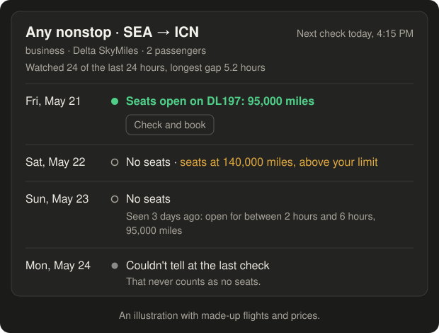
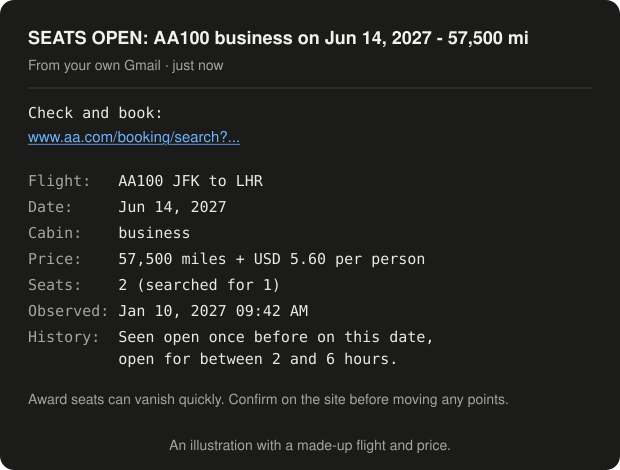

<p align="center">
  
</p>

<p align="center">
  <a href="https://github.com/xiuruichen/jetbridge/actions/workflows/ci.yml"></a>
  <a href="https://github.com/xiuruichen/jetbridge/tags"></a>
  <a href="LICENSE"></a>
  
  
</p>

<p align="center">
  <a href="#get-started"><b>Get started</b></a> ·
  <a href="#what-you-can-ask">What you can ask</a> ·
  <a href="#how-it-works">How it works</a> ·
  <a href="#how-it-compares">How it compares</a> ·
  <a href="#good-to-know">Good to know</a> ·
  <a href="docs/guide.md">Full guide</a>
</p>

Tell jetbridge the flight, cabin, dates and miles you want, in plain words. It searches the airline's
own website several times a day from your computer. When seats appear for your whole party, it searches
again live, then emails you the price and a booking link. If that second search can't tell, the email
says it's unconfirmed.

**It's free, with no account or subscription.** It works with American AAdvantage, Delta SkyMiles and
United MileagePlus, including the partner flights they sell.


## Why jetbridge

- **It double-checks before alerting you.** Seats are searched again live a minute or two later, so you
  aren't sent after seats that were only there for a moment.
- **It watches what you actually want.** One exact flight, or any nonstop on a route, in your cabin,
  under your price limit. Searches use your real party size, so seats for one don't count for two.
- **It proves it's watching.** You can see how many of the last 24 hours each flight stayed on schedule,
  and an unclear answer is never reported as "no seats".
- **It builds a record of your flight.** Past openings, how long they lasted, their prices, seats just
  above your limit, and other flights it saw on your route.
- **It spends searches where they matter.** Dates get checked more often close to departure and after
  seats or prices move, within fixed daily limits.
- **It keeps your details on your computer.** It searches as a guest, and never logs in, books anything
  or moves your miles.

<table>
  <tr>
    <td width="50%"></td>
    <td width="50%"></td>
  </tr>
  <tr>
    <td align="center"><b>See it all in chat</b></td>
    <td align="center"><b>Alerts with the link first</b></td>
  </tr>
</table>

> [!IMPORTANT]
> Automated searching likely goes against the airlines' terms of use, so [read how jetbridge handles
> that](docs/guide.md#blocks-and-the-airlines-terms) first. Checks only run while your computer is on,
> and seats that open and close between checks can be missed. Don't rely on it as your only way of
> finding seats.

## Get started

On Windows, open PowerShell and paste this line. Have a
[Gmail app password](https://myaccount.google.com/apppasswords) ready, which is how alerts get sent.

```powershell
irm https://raw.githubusercontent.com/xiuruichen/jetbridge/main/install.ps1 | iex
```

It asks before installing anything that's missing, offers to connect Claude Desktop if you have it, and
then asks you a few questions about your flight. Running a script from the internet means trusting it,
so you can [read it first](install.ps1).

<details>
<summary><b>On a Mac?</b> There's an experimental version.</summary>

<br>

It passes its automated tests on GitHub's Mac machines, but hasn't been tried on a real Mac yet. Airline
searches, sleep and Claude Desktop may not work as they do on Windows, and Chrome may appear during
checks. If you'd like to try it, paste this into Terminal, then
[follow the checklist and tell us how it went](docs/mac-testing.md).

```bash
curl -fsSL https://raw.githubusercontent.com/xiuruichen/jetbridge/main/install.sh | bash
```

</details>

## What you can ask

With [Claude Desktop](https://claude.com/download) connected, just say what you want in your own words.
Nothing is saved or deleted until you say yes. Claude is optional, and
[simple commands](docs/guide.md#command-reference) do all the same things.

| You could say | What happens |
|---|---|
| "Watch AA100 from New York to London in business on June 14-16 2027 using American miles" | Claude asks about anything missing, shows a review, then saves it and runs the first check |
| "Tell me about any nonstop business seats from Seattle to Seoul on Delta miles" | Watches every nonstop on that route, with its own alert for each flight that opens |
| "Watch CX805 or CX889, business or first" | One review covers them all, and they share their searches |
| "Show me my flights" | Draws a board in the chat |
| "How has that flight been doing? Has it ever opened?" | Shows past openings, how long they lasted and their prices |
| "Lower the limit to 90k and add June 20" | Changes the watch and keeps its history |
| "Also alert ann@example.com" | Adds them, and they get one short note saying why. They don't need to install anything |
| "This one matters most" | That watch goes first and gets checked more often |
| "Why aren't I getting alerts?" | Finds the problem and how to fix it, or prepares a report you can post |

## How it works

1. **Your computer searches.** Every 15 minutes it runs whatever checks are due, using Chrome as a
   guest, one airline at a time, with waits between searches.
2. **It re-checks anything new.** If seats appear, it searches again live a minute or two later.
3. **You get the alert.** The email has the booking link first, and you can
   [add phone alerts](docs/guide.md#phone-alerts-optional) too. You book it yourself.
4. **It tells you when something's off.** A daily summary shows what it watched. If that email stops,
   the watcher isn't running.

More about [how checks are timed](docs/guide.md#how-checks-work), including why there's no
machine learning yet: there's no good public data on when seats are released, and a single watch doesn't
produce enough to learn from.

## How it compares

jetbridge is for when you already know the flight or route you want. If you're flexible, a search site
covers far more, and the two work well together. Here's the best-known one, as checked on Nov 3, 2026.
Its details can change, so check [seats.aero](https://seats.aero) itself.

| | jetbridge | seats.aero |
|---|---|---|
| **Best for** | A flight or route you already know | Browsing many programs and routes |
| **Programs** | American, Delta and United | [24 programs](https://awardwallet.com/travel/seats-aero-guide/) |
| **Cost** | Free | [Free plan, or Pro at $12.99 a month from Nov 9, 2026](https://upgradedpoints.com/news/seats-aero-price-increase) |
| **How far ahead** | As far as the airline shows | [60 days free, a year on Pro](https://awardwallet.com/travel/seats-aero-guide/) |
| **Alerts** | One flight or any nonstop, re-checked live on the airline's site first | [Unlimited, for direct routes, by date, program and cabin](https://docs.seats.aero/article/43-creating-and-managing-alerts) |
| **Where it runs** | Your computer, which has to be on | Its own service, so your computer can be off |
| **In Claude** | Yes, on your computer | Yes, through its [official connector](https://seats.aero/mcp) |

## Good to know

- **Your computer has to be on, awake and logged in.** `jetbridge keep-awake on` stops it sleeping while
  plugged in, and you can undo that.
- **Sending alerts needs a Gmail account** with 2-Step Verification. Alerts can go to any address.
- **Sites can change or block it.** If that happens, it stops and tells you, rather than saying "no
  seats". [Here's how it stays careful](docs/guide.md#blocks-and-the-airlines-terms).
- **What leaves your computer:** searches to the airline, emails through Gmail, anything you say to
  Claude, and [a few optional things](docs/guide.md#where-your-data-lives).

## Learn more

- [The full guide](docs/guide.md): every option, command, email and fix
- [Changelog](CHANGELOG.md)
- [Contributing](CONTRIBUTING.md) and [how your details are handled](SECURITY.md)
- [Something wrong?](https://github.com/xiuruichen/jetbridge/issues/new/choose) Run `jetbridge report`
  or ask Claude to "report this problem". It prepares an issue with nothing personal in it

## License

[MIT](LICENSE). jetbridge isn't affiliated with any airline or with Anthropic.
